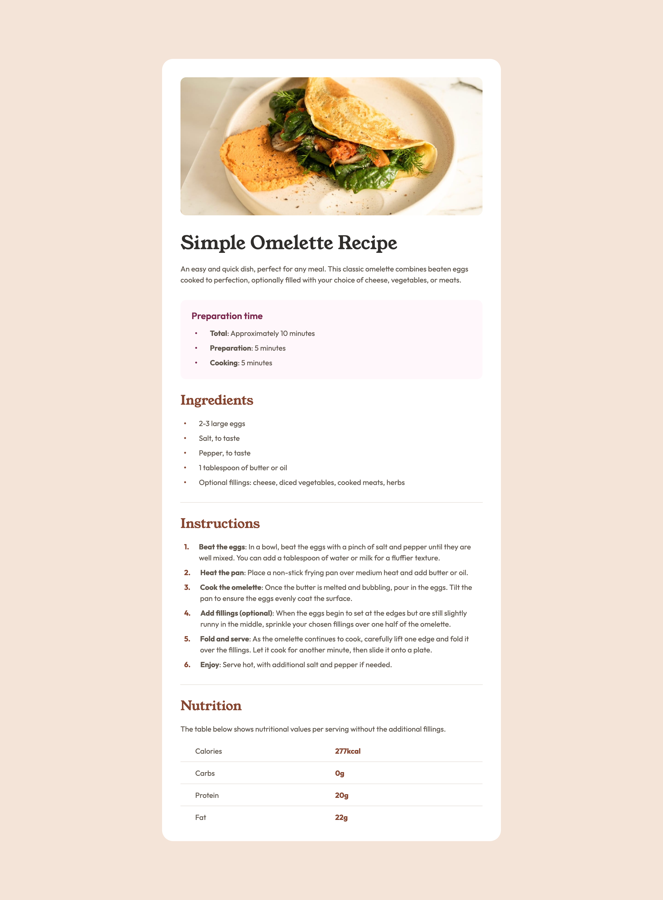
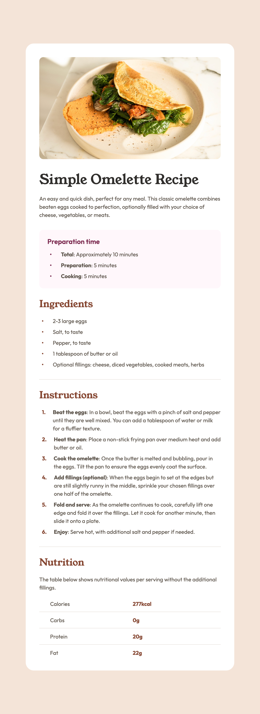
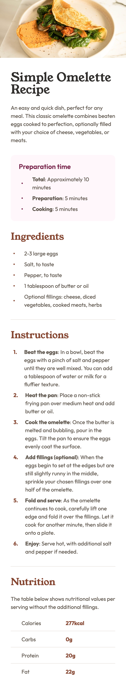
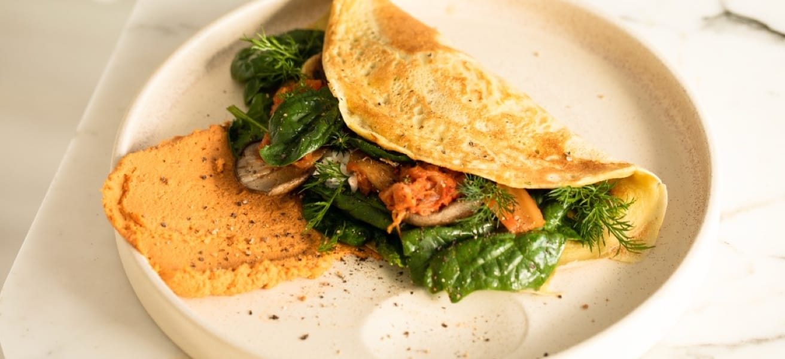

# Frontend Mentor - Recipe page solution

This is a solution to the [Recipe page challenge on Frontend Mentor](https://www.frontendmentor.io/challenges/recipe-page-KiTsR8QQKm).

## Table of contents

- [Overview](#overview)
  - [Screenshot](#screenshot)
  - [Links](#links)
- [My process](#my-process)
  - [Built with](#built-with)
  - [What I learned](#what-i-learned)
  - [Continued development](#continued-development)
  - [Useful resources](#useful-resources)
  - [AI Collaboration](#ai-collaboration)
- [Author](#author)

## Overview

### Screenshot

<table>
  <tr>
    <td width="55%" align="center" valign="top">
      <p align="left" style="margin: 0">Desktop</p>
      
    </td>
    <td width="30%" align="center" valign="top">
      <p align="left" style="margin: 0">Tablet</p>
      
    </td>
    <td width="20%" align="center" valign="top">
      <p align="left" style="margin: 0">Mobile</p>
      
    </td>
  </tr>
</table>

### Links

- Solution URL: [GitHub Repository](https://github.com/the-firstrong/recipe-page)
- Live Site URL: [Recipe Page](https://the-firstrong.github.io/recipe-page/)

## My process

### Built with

- Semantic HTML5 markup
- CSS custom properties
- Flexbox
- Responsive disign

### What I learned

- How to use the HTML ```<picture>``` element and ```<source>``` with media queries to serve different images for different screen sizes.
```html
<picture class="preview">
  <source media="(min-width: 35.0625rem) and (max-width: 48rem)" srcset="./assets/images/image-omelette-tablet.jpg">
  
</picture>
```

- How to create custom list markers using CSS.

### Continued development

- Improve responsive design and list styling.

### Useful resources

- [freeCodeCamp](https://www.freecodecamp.org/) - This helped me learn and practice HTML and CSS.

### AI Collaboration

- **ChatGPT:** Used for learning HTML and CSS, debugging and understading solutions.
- **GitHub Copilot:** Used for code suggestion and autocomplete.

## Author

- GitHub - [@the-firstrong](https://github.com/the-firstrong)
- Frontend Mentor - [@the-firstrong](https://www.frontendmentor.io/profile/the-firstrong)